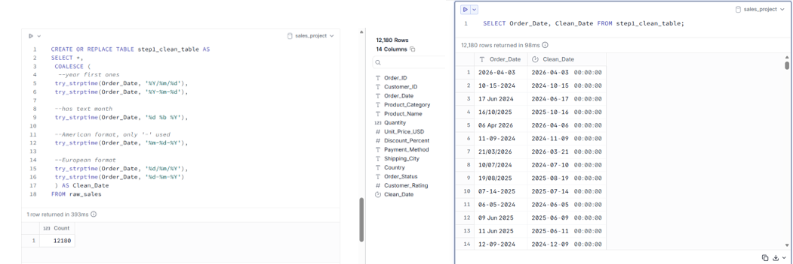
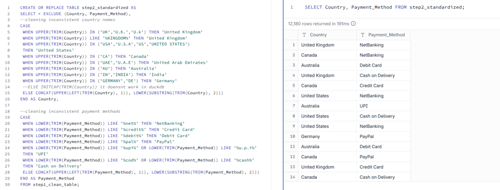
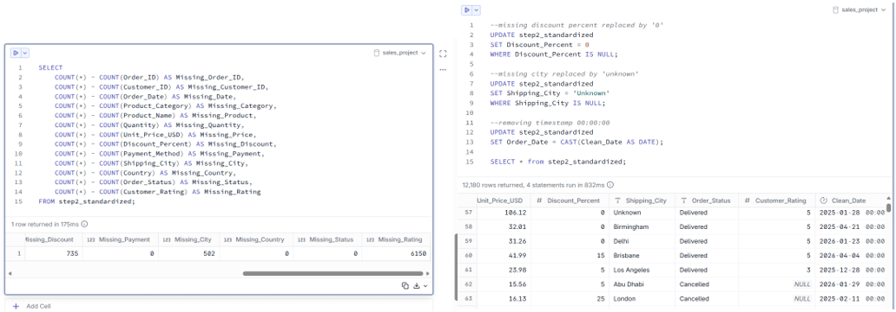
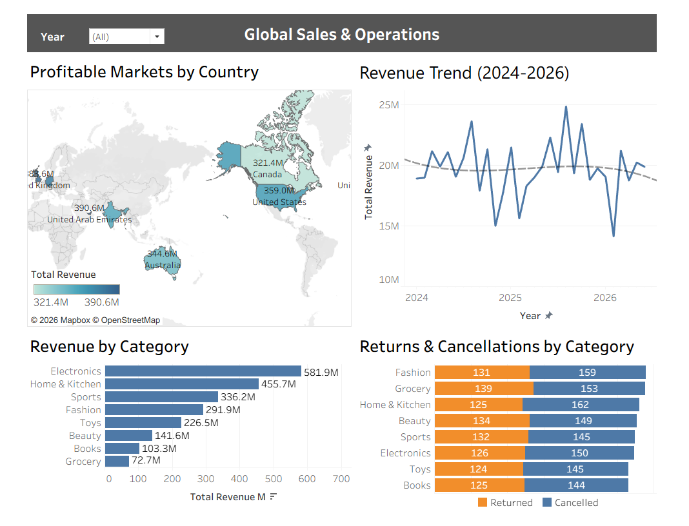

# 📊 Global Sales & Operations Dashboard

## 📌 Project Overview
This project presents an end-to-end data analysis of a messy, global e-commerce dataset. The goal was to take raw, unstructured data, perform rigorous data cleaning, extract meaningful business insights, and build an interactive Tableau dashboard to aid executive decision-making.

🔗 **[View the Interactive Dashboard on Tableau Public](https://public.tableau.com/shared/M6DHPQJQB?:display_count=n&:origin=viz_share_link)**

---

## 🛠️ Tech Stack & Tools
*   **Data Cleaning & Transformation:** DuckDB (SQL, String Manipulation, Aggregations)
*   **Data Visualization:** Tableau Public
*   **Documentation:** Markdown, Word

---

## 🧹 Data Cleaning & Preparation Process
The raw dataset contained several data quality issues that would have skewed the analysis. I used SQL (DuckDB) to resolve the following challenges:

1.  **Inconsistent Date Formats:** The `Order_Date` column contained at least 5 different formats (e.g., `YYYY-MM-DD`, `DD/MM/YYYY`, `DD-Mon-YY`). I used `STRPTIME` and `CASE WHEN` logic to standardize all dates into a single `YYYY-MM-DD` format.
2.  **Inconsistent Categorical Text:** Standardized country names (e.g., "USA", "U.S.A", "US" → "United States") and payment methods (e.g., "upi", "U.P.I" → "UPI") using `CASE WHEN` and `LIKE` operators.
3.  **Invalid Quantities & Logical Inconsistencies:** Identified rows with `Quantity <= 0` that were still marked as "Delivered". These were filtered out of the final sales dataset to ensure accurate revenue calculations.
4.  **Duplicate Records:** Identified and removed exact duplicate orders using `SELECT DISTINCT` to prevent double-counting and ensure data integrity.
5.  **Handling Missing Values:** Managed missing data strategically (e.g., filled missing `Discount_Percent` with 0, labeled missing `Shipping_City` as "Unknown", and left missing `Customer_Rating` as NULL to avoid skewing the average CSAT).

### 🖼️ Some of the SQL Query Screenshots (Proof of Work)
*(Click on the images to view them in full size)*

**1. Fixing Inconsistent Date Formats:**

**2. Fixing Inconsistent Names:**

**3. Handling Missing Values (Imputation):**

---

## 💡 Key Business Insights
Based on the cleaned data and Tableau dashboard, here are the major findings:

*   **Revenue Concentration:** The business is highly reliant on **Electronics ($581.9M)** and **Home & Kitchen ($455.7M)**. Underperforming categories like Grocery ($72.7M) require a strategic review.
*   **Declining Trend:** The overall monthly revenue trend shows a slight decline from 2024 to 2026. While seasonal peaks exist, their magnitude is shrinking year-over-year.
*   **Operational Anomaly (Returns):** Return and cancellation rates are uniformly distributed across all product categories (~250-300 per category). This suggests a **systemic operational issue** (e.g., logistics delays, checkout friction) rather than product-specific quality problems.
*   **Geographic Focus:** The US and UAE are the primary revenue drivers. The UAE shows disproportionately high revenue, warranting a check for large B2B clients or data anomalies.

---

## 📊 Dashboard Preview

---

## 📂 Repository Structure
*   `main_sales.csv`: The final, cleaned dataset used for sales analysis.
*   `returns.csv`: The cleaned dataset containing only returns and cancellations.
*   `sales_project.duckdb`: The DuckDB database file containing all SQL queries, raw tables, and clean tables.
*   `sales_project_documentation.docx`: Detailed documentation of the data cleaning process and exploratory data analysis (EDA).
